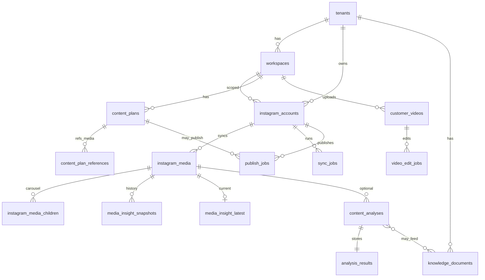

# Instagram Content Intelligence & AI Production — Architecture Plan

**Status:** Audit + plan only (no implementation)  
**Date:** 2026-11-02 (refined same day after peer review)  
**Constraint:** Do not modify Auth / TenantContext / Platform Admin / existing Liquibase `001`–`003` / production deploy in this phase. Local-first.

---

## 0. Executive recommendation

**Recommended architecture:** modular monolith in Spring Boot for domain + orchestration, FastAPI (`ai-service`) for FFmpeg + vision/LLM, Redis-backed job queues, PostgreSQL as system of record, object storage for derived media (frames, uploads, publish staging). Instagram Graph via **Instagram API with Instagram Login** as the primary path (Business/Creator without mandatory Facebook Page), with Facebook Login path as a later optional adapter if Meta App Review requires it for specific metrics.

**Start implementation with Module A — Instagram Connect + Media Sync (read-only).**  
Reason: every later feature (insights, AI analysis, knowledge base, publish feedback) depends on durable, tenant-scoped `instagram_media` rows and encrypted account tokens. AI-first without sync creates empty pipelines and fake assumptions about Meta fields.

**Do not** auto-analyze every synced post. Sync is automatic; AI analysis is **explicit user selection**.

---

## 1. Current project audit

### 1.1 What exists (DONE)

| Layer | Reality |
|-------|---------|
| Product | Multi-tenant SaaS; tenant/workspace/membership |
| BE | Java 21, Spring Boot 4.1.2, JPA, Liquibase SQL (`001`–`003`) |
| Auth | JWT memory access + HttpOnly refresh, CSRF, fail-fast secrets (Phase-1) |
| Isolation | `TenantContextFilter` + membership revalidation (H2) |
| Platform | Read-only `/api/v1/platform/**` (H1) |
| Access | Page grants (`app_pages` / `user_page_access`) |
| UI | Angular 22: auth, dashboard, tenants, workspaces, access, i18n |
| AI | FastAPI stub: `/health` only (`ai-service/app/main.py`) |
| Infra | Docker Compose: Postgres 16 + Redis 7; Redis **not wired** in Spring (autoconfig excluded) |
| Storage | Folder present; no media pipeline |
| Instagram | **None** (no OAuth, no Graph client, no media tables) |

### 1.2 Explicit gaps for this product vision

- No Instagram account entity / encrypted tokens  
- No media repository / sync jobs  
- No insights / historical snapshots  
- No AI analysis jobs / structured result storage  
- No knowledge base / RAG  
- No content planning / scripts  
- No customer video upload / edit pipeline  
- No publishing containers / status machine  
- No background worker / Redis queue integration  
- No object storage abstraction  
- Redis present but unused (good for future jobs without new infra inventing)

### 1.3 Architectural assets to reuse (do not rewrite)

- `TenantContext` / `TenantMembershipService` for all tenant APIs  
- `ApiResponse` / `PageResponse` / `messageKey` i18n  
- Page Access: add new `app_pages` codes when UI ships  
- Profiles `dev` / `prod` / `test`; secrets via env  
- Isolation test patterns (`TenantContextIsolationIntegrationTest`)

### 1.4 Hard non-goals for first implementation slices

- Do not change Auth/H1/H2 foundations  
- Do not enable Redis by rewriting unrelated modules prematurely without a job design  
- Do not invent Meta capabilities not documented  
- Do not auto-AI-analyze the full media library  

---

## 2. Backend package structure (proposed)

```text
uzeduai.be
  auth|tenant|workspace|access|platform|security|common   # EXISTING — leave alone
  instagram/
    oauth/          # connect, callback, state, long-lived token refresh cron
    account/        # linked IG professional accounts (AES-GCM token attribute converter)
    media/          # synced posts, children (carousel); refreshUrlIfExpired
    insights/       # latest + historical snapshots
    sync/           # historical + incremental sync orchestration
    publish/        # container create / publish / status
    client/         # Graph HTTP client, rate-limit, retries
  content/
    analysis/       # analysis requests, status, results JSON
    knowledge/      # tenant knowledge docs / embeddings later
    planning/       # ideas, scripts, storyboards, approvals
  mediaops/
    upload/         # customer video uploads (NOT IG sync)
    edit/           # edit jobs, ffmpeg plans, previews
  jobs/
    api/            # enqueue endpoints / admin status (optional)
    worker/         # if in-process; or separate worker module
  storage/          # object storage ports (S3/MinIO/local)
```

**Rule:** Instagram sync packages must not depend on `mediaops.upload`. Shared ports (`FfmpegPort`, `VisionPort`, `LlmPort`) live in `common` or thin `ai` client package.

**Python (`ai-service`):**

```text
app/
  main.py
  api/           # analyze-image, analyze-video, transcribe, edit-plan, render
  ffmpeg/
  vision/
  llm/           # Ollama/Qwen adapters
  schemas/       # Pydantic contracts matching BE DTOs
```

BE owns multi-tenant authorization and persistence; AI service is **stateless worker** called with pre-authorized job payloads (tenantId in payload for logging only; never trusted for auth).

---

## 3. Angular feature structure (proposed)

```text
UI/src/app/features/
  instagram/
    connect/           # OAuth start / status
    posts/             # library, filters, select for analysis
    post-detail/       # caption, media preview, insights charts
  insights/
    leaderboard/       # best posts (sort by metrics)
  analysis/
    queue/             # selected posts → analysis jobs
    result/            # structured JSON viewer
  knowledge/           # tenant knowledge notes (manual + derived)
  planning/
    brief/             # idea + selected reference posts
    script/            # script / voiceover / shot list + approve
  studio/              # customer video upload & AI edit (separate nav)
  publish/
    draft/             # approve → publish → status
```

New `app_pages` (future Liquibase changeset when implementing UI): e.g. `INSTAGRAM`, `INSIGHTS`, `ANALYSIS`, `PLANNING`, `STUDIO`, `PUBLISH`.  
`PLATFORM_ADMIN` pages remain separate; do not overload `/app/tenants`.

---

## 4. Database ERD (logical)



All domain tables include `tenant_id` (+ `workspace_id` where workspace-scoped). Unique keys always tenant-aware.

---

## 5. Table responsibilities (proposed)

| Table | Purpose | Key relations / notes |
|-------|---------|------------------------|
| `instagram_accounts` | Linked IG professional account | `tenant_id`, `workspace_id`, encrypted tokens, IG user id, username, token expiry, scopes, status |
| `instagram_oauth_states` | CSRF state for OAuth | short-lived, single-use |
| `instagram_media` | Synced posts | unique `(tenant_id, ig_media_id)`; type, caption, permalink, timestamps, analysis_status, sync metadata |
| `instagram_media_children` | Carousel items | parent media FK; child ig id; type; media URL/ref; **no caption/permalink if Meta omits** |
| `media_insight_latest` | Latest metrics denormalized for sort/UI | 1:1 media; nullable metrics; `fetched_at` |
| `media_insight_snapshots` | Historical series | media + `captured_at` + metrics JSON/columns; append-only |
| `sync_jobs` | Historical/incremental sync runs | account, type, cursor, status, error, rate-limit info |
| `content_analyses` | User-requested AI jobs | media_id OR customer_video_id; status queue; model/prompt versions |
| `analysis_results` | Structured JSON result | FK analysis; jsonb payload; schema_version |
| `knowledge_documents` | Tenant knowledge base entries | source_type (manual/analysis/insight), jsonb body; optional embedding_id later |
| `content_plans` | New content briefs/scripts | workspace; status draft→approved |
| `content_plan_references` | Selected reference posts | plan ↔ media |
| `customer_videos` | Uploaded source videos | storage key, metadata, duration |
| `video_edit_jobs` | Edit pipeline status | plan, ffmpeg steps, preview URL |
| `publish_jobs` | IG publish attempts | account, media containers, status, resulting ig_media_id, idempotency key |
| `ai_model_runs` (optional) | Cost/debug audit | provider, model, tokens, latency |

**Analysis status on `instagram_media` (required):**  
`NOT_ANALYZED` | `QUEUED` | `RUNNING` | `ANALYZED` | `FAILED`

---

## 6. Instagram Graph API integration flow

### 6.1 Login path recommendation

**Primary:** Instagram API **with Instagram Login** (`graph.instagram.com`)

- Fits Business/Creator without forcing Facebook Page for basic media sync.  
- Documented scopes (names evolve; verify at App Review time), commonly including:
  - `instagram_business_basic` — media read  
  - `instagram_business_manage_insights` — insights (when granted)  
  - `instagram_business_content_publish` — publishing  

**Secondary (optional later):** Instagram API with Facebook Login (`graph.facebook.com`) if a specific metric or product feature is **only** available there (e.g. some aggregated “total_*” / ads-related fields documented as Facebook-Login-only).

### 6.2 Connect flow (high level)

1. User activates workspace (existing auth).  
2. `GET /api/v1/instagram/oauth/start` → creates `oauth_state` (CSRF, tenant/workspace bound) → redirect Meta.  
3. Callback validates state, exchanges code → long-lived token.  
4. Persist `instagram_accounts` with **encrypted** access token; never log token.  
5. Enqueue **historical sync** job.

### 6.3 Media read (documented capabilities)

Typical readable fields for IG Media (confirm per API version):  
`id`, `caption` (not on album children), `media_type` (`IMAGE` | `VIDEO` | `CAROUSEL_ALBUM`), `media_url`, `permalink`, `timestamp`, `thumbnail_url`, `children` edge for albums.

**Do not assume:** private personal (non-professional) accounts; arbitrary story archive without Story-specific APIs/permissions; permanent CDN URLs.

**CDN URL expiry (mandatory design):** Meta `media_url` / `thumbnail_url` are signed and expire (often → HTTP 403).  
- Persist last known URL + `media_url_fetched_at`.  
- Before UI hot-path failure, AI download, or publish staging: call `refreshUrlIfExpired` → `GET /{ig-media-id}?fields=media_url,thumbnail_url` and update row.  
- For posts selected for AI / long-term studio use: optionally **cache binary** into object storage under `tenant/ws/ig-cache/{ig_media_id}/` so analysis does not depend on CDN TTL.

### 6.4 Publishing (documented capabilities)

Documented Content Publishing pattern:

1. `POST /{ig-user-id}/media` create container (`image_url` / `video_url` / REELS / CAROUSEL children)  
2. Poll container status until finished  
3. `POST /{ig-user-id}/media_publish` with `creation_id`  

Constraints (documented): media must be on a **publicly reachable URL**; containers expire (~24h); account publish rate limit (documented **100 API publishes / 24h rolling**; carousel counts as one); check `content_publishing_limit`.

---

## 7. Historical sync & incremental sync

### 7.1 Historical sync

- Trigger: account connected / manual “Resync”.  
- Walk `GET /{ig-user-id}/media?fields=...&after=cursor` until exhausted or configured max pages.  
- Upsert by `(tenant_id, ig_media_id)` — **idempotent**, never duplicate.  
- For `CAROUSEL_ALBUM`, fetch `/children` and upsert children.  
- Persist sync cursor + `last_synced_at` on account.  
- Respect Graph rate-limit headers; exponential backoff; job status `RATE_LIMITED` / retry.

### 7.2 Incremental sync

- Periodic job (e.g. every N minutes per account, jittered).  
- Strategy A (simple): first page(s) of media, upsert new ids; stop when hitting known recent ids.  
- Strategy B (later): webhooks if Meta product supports for the chosen login type — **only after verifying webhook availability for the selected API configuration**.  
- Never mark media `QUEUED` for AI on sync.

### 7.3 Error handling

- Classify: auth revoked → account `NEEDS_REAUTH`; 4xx validation vs 5xx retry; rate limit → delay.  
- Dead-letter after N attempts with user-visible sync error.

---

## 8. Insights sync architecture

### 8.1 What Meta documents (treat as constraints)

- Endpoint pattern: `GET /{ig-media-id}/insights?metric=...`  
- Metrics availability **depends on media product type** (Feed/Reel/Story differ).  
- If a metric is unavailable, API may return **empty data**, not `0` — store **NULL**, never invent zero.  
- Insight calculation can lag (docs cite delays up to ~48h).  
- Some metrics organic-only; aggregated “total_*” variants may require Facebook Login path — **do not mix without labeling source**.  
- `views` is the modern consumption metric (distinct from legacy impressions terminology).  
- `reach` is unique accounts reached (when available).  
- Engagement fields commonly requested where supported: `likes`, `comments`, `shares`, `saved` (names/`saved` vs `saves` — bind to exact metric names returned by the API version in use).

### 8.2 Storage model

- **Snapshot row** every successful fetch: absolute metric values at `captured_at` (supports day1=1000, day2=5000 history).  
- **Latest row** updated in place for sorting “best posts”.  
- Store `metrics_raw jsonb` + typed columns for queryable fields.  
- Store `fetched_at` per snapshot; optional `metric_availability` map.

### 8.3 Engagement rate (document formula — product decision)

Because Meta does not ship a single universal “engagement rate” for all media types, **compute in-app** and document:

**Recommended v1 formula (organic counts, when denominator available):**

```text
engagement_rate = (likes + comments + shares + saves) / NULLIF(reach, 0)
```

- If `reach` is NULL → `engagement_rate` NULL (do not use views as silent substitute without product flag).  
- Alternative display metric: `engagement_per_view = interactions / NULLIF(views, 0)` — label clearly in UI as different from reach-based ER.  
- Version the formula in `insight_formula_version` so historical UI stays honest.

### 8.4 Scheduler

- Priority: recently published + selected “track” posts more frequent; long-tail less frequent.  
- Batch per account with global and per-account rate budgets.  
- Never block HTTP request threads for bulk insight pulls.

---

## 9. AI analysis pipeline

### 9.1 Trigger

User selects one or more posts → `POST /analyses` → status `QUEUED` only for those ids.

### 9.2 Pipeline (BE orchestrates, AI executes)

1. Resolve media + membership; load/refresh `media_url` if needed.  
2. Image: download → vision prompt → structured JSON.  
3. Video/Reel: AI service FFmpeg sample frames (interval / scene detect) → vision per keyframe → optional ASR transcription → merge LLM summarization.  
4. Caption: NLP/LLM extract hashtags, CTA, tone.  
5. Persist `analysis_results` jsonb + model/prompt versions; set media `ANALYZED` / `FAILED`.  
6. Optionally emit `knowledge_documents` derived summary (tenant-scoped).

### 9.3 Result schema (v1)

```json
{
  "schemaVersion": "1.0",
  "contentCategory": "",
  "productOrService": "",
  "mainTopic": "",
  "targetAudience": "",
  "hook": "",
  "scriptStructure": [],
  "visualStyle": {},
  "cta": "",
  "strengths": [],
  "weaknesses": [],
  "recommendations": [],
  "captionInsights": {},
  "frameInsights": [],
  "transcript": null
}
```

### 9.4 Cost control

- Max concurrent analyses per tenant.  
- Reuse existing `ANALYZED` result unless `force=true`.  
- Do not re-send full library to LLM for every plan — use stored JSON + knowledge docs.

---

## 10. Knowledge Base architecture

**Phase KB-1 (now-design / implement after analysis):** PostgreSQL `knowledge_documents` jsonb, tenant_id required, source links.

**Phase KB-2 (later):** embeddings table / pgvector or external vector DB; RAG retrieval scoped by `tenant_id` in every query filter (defense in depth).

Sources:

- Selected analyzed posts (summaries, not raw pixels every time)  
- High-performing posts (join insights latest)  
- Manual tenant notes (products/services)  
- Post-publish feedback summaries  

**Isolation:** repository methods always `WHERE tenant_id = :tenantId`; never cross-tenant similarity search.

---

## 11. Content planning & script generation

Flow:

1. Brief (text + optional product facts)  
2. Select reference media ids (must belong to tenant/workspace)  
3. Load analysis JSON + insight rankings for references  
4. AI proposes idea → script → voiceover → shot list  
5. Human approve; store versions  

**Guardrail prompt policy:** “Do not copy caption/script verbatim; transfer successful patterns.” Enforce in system prompt + optional similarity check later.

---

## 12. Customer video upload & AI editing (separate module)

Independent of Instagram sync:

1. Upload to object storage (tenant/workspace prefix)  
2. Probe metadata (ffprobe)  
3. Scene/frame extraction  
4. AI understanding + weak-segment detection  
5. Edit plan → user approve  
6. FFmpeg cut/concat → captions/audio → **9:16** preview  
7. Optional handoff to publish module (public URL staging)

Shared: `ai-service` FFmpeg/vision; **not** `instagram_media` tables.

---

## 13. Instagram publishing

- Only after explicit approve.  
- Idempotency key per plan/job to prevent double publish.  
- State machine: `DRAFT` → `UPLOADING` → `CONTAINER_CREATED` → `PUBLISHING` → `PUBLISHED` | `FAILED`.  
- On success: store returned IG media id; optionally enqueue sync/insights for that id.  
- Enforce Meta’s publish rate limit client-side before call.  
- **Public HTTPS URL (Meta crawls the file):** `localhost` / private MinIO is **not** reachable by Instagram.  
  - Local M5: Cloudflare Tunnel, Ngrok, or temporary public S3/R2 object URL.  
  - Dev docs must state this explicitly before first publish test.

### 13.1 Long-lived token lifecycle

Instagram User long-lived tokens are typically valid on the order of **~60 days** (confirm current Meta docs at impl time). If the user is idle, the token expires and sync/publish break.

**Required jobs (M1+):**

- Persist `token_expires_at` on `instagram_accounts`.  
- Daily cron: accounts with expiry within **10 days** → call Meta refresh endpoint; update encrypted token + expiry.  
- On `OAuthException` / invalid token during sync → set account status `NEEDS_REAUTH`; stop silent retries that burn rate limits.  
- UI banner: “Instagram ulanishini yangilang”.

---

## 14. Background jobs & queue

**Recommendation (prefer concrete stack over hand-rolled Streams):**

| Option | Pros | Cons |
|--------|------|------|
| **JobRunr** (Postgres or Redis) | Dashboard UI, retries, DLQ-ish failures, low boilerplate on Boot | Extra dependency; verify Spring Boot 4.1.2 compatibility before lock-in |
| Spring + Redis Streams / listener | Already have Redis in Compose; fine-grained control | More DIY for dashboard/retry/DLQ |
| In-process `@Scheduled` only | Simplest for M1 sync spike | Does not scale; weak for AI/video |

**Decision for M0/M1:** prefer **JobRunr with PostgreSQL storage** for local simplicity (one less moving part than Redis Streams), keep Redis available for rate-limit counters / locks. Re-evaluate Redis-backed JobRunr or Streams if multi-instance workers appear.

Job types:

- `IG_HISTORICAL_SYNC`, `IG_INCREMENTAL_SYNC`  
- `IG_TOKEN_REFRESH`  
- `IG_INSIGHTS_SYNC`  
- `CONTENT_ANALYSIS`  
- `VIDEO_EDIT`  
- `IG_PUBLISH`  
- `FEEDBACK_ANALYSIS`  

Requirements:

- Tenant/workspace/account **and acting userId** on every payload  
- **Never trust HTTP `TenantContext` ThreadLocal in workers** — always re-load account/media by id and re-check `TenantMembershipService` (or equivalent) before side effects  
- Idempotent handlers  
- Visibility timeout + retry + DLQ / failed-job UI  
- Job payload must not contain raw access tokens (load from encrypted column inside worker)

---

## 15. Storage architecture

| Asset | Store |
|-------|--------|
| IG original CDN URLs | DB references + refresh; optional cache copy of selected assets for AI |
| Analysis frames | Object storage `tenant/ws/analysis/{id}/frames/` |
| Customer uploads | `tenant/ws/uploads/{id}/` |
| Edit renders / previews | `tenant/ws/renders/{id}/` |
| Publish staging | Public-readable short-lived URLs |

Local: MinIO or filesystem under `storage/` with path isolation. Prod later: S3-compatible.

---

## 16. REST API endpoints (draft)

All under `/api/v1`, authenticated, membership-checked (except OAuth callback specifics).

### Instagram

- `POST /instagram/oauth/start`  
- `GET /instagram/oauth/callback`  
- `GET /instagram/accounts`  
- `DELETE /instagram/accounts/{id}` (disconnect — later)  
- `POST /instagram/accounts/{id}/sync`  
- `GET /instagram/media` (filter type, analysis_status, sort by insight)  
- `GET /instagram/media/{id}`  
- `GET /instagram/media/{id}/insights` (latest + history query)

### Analysis / knowledge / planning

- `POST /analyses` `{ mediaIds: [] }`  
- `GET /analyses/{id}`  
- `GET /knowledge/documents`  
- `POST /knowledge/documents` (manual)  
- `POST /content-plans`  
- `POST /content-plans/{id}/generate`  
- `POST /content-plans/{id}/approve`

### Studio (customer video)

- `POST /studio/videos` (upload)  
- `POST /studio/videos/{id}/edit-jobs`  
- `GET /studio/edit-jobs/{id}`

### Publish

- `POST /publish-jobs`  
- `GET /publish-jobs/{id}`

Envelope remains `{ success, data, messageKey, messageArgs, timestamp }`.

---

## 17. Tenant isolation & security

- Every query: `tenant_id` (+ workspace) from server membership / active context — never trust client headers for authz.  
- Instagram tokens: **AES-GCM** via JPA `@Convert(converter = EncryptedStringConverter.class)` on `accessToken` (and refresh token if stored); key from env `IG_TOKEN_ENCRYPTION_KEY` (fail-fast in prod if missing); never log plaintext or ciphertext unnecessarily.  
- OAuth `state`: random, single-use, bound to user+tenant+workspace, short TTL.  
- AI service: mTLS or shared secret; accepts job ids; BE re-checks ownership before returning results.  
- Object keys prefixed by tenant/workspace; signed URLs.  
- Cross-tenant tests mandatory for media, insights, analyses, uploads, publish.  
- Platform Admin inventory ≠ Instagram data access unless explicitly designed later.

---

## 18. Test strategy

| Layer | Focus |
|-------|--------|
| Unit | Graph client parsing, upsert idempotency, ER formula, status transitions |
| Integration | OAuth state CSRF; media sync dedupe; membership 403 cross-tenant; analysis only for selected ids |
| Contract | WireMock/VCR for Graph fixtures (media list, insights empty metric, publish limit) |
| AI service | FFmpeg frame extract on sample mp4; schema validation |
| Regression | Existing Auth / H2 / H1 / Access tests must stay green |

Do not require live Meta calls in CI; use recorded fixtures.

---

## 19. Implementation roadmap (phased)

### Liquibase split (do not dump all tables into one file)

When coding starts, **new** SQL changelogs only (never edit `001`–`003`):

| File | Phase | Tables |
|------|-------|--------|
| `004-instagram-core.sql` | M1 | `instagram_accounts`, `instagram_oauth_states`, `instagram_media`, `instagram_media_children`, `sync_jobs` |
| `005-instagram-insights.sql` | M2 | `media_insight_latest`, `media_insight_snapshots` |
| `006-content-analysis-kb.sql` | M3/M4 | `content_analyses`, `analysis_results`, `knowledge_documents`, plan tables as needed |
| `007-studio-publish.sql` | M5/M6 | `customer_videos`, `video_edit_jobs`, `publish_jobs` (+ optional `ai_model_runs`) |

### Phase M0 — Foundations for media domain (prep)

- Job runner spike (JobRunr + Postgres preferred) behind feature flag  
- Object storage port + local/MinIO backend  
- `EncryptedStringConverter` + prod fail-fast for `IG_TOKEN_ENCRYPTION_KEY`  
- Page codes stub optional  

**Acceptance:** Compose up; sample job runs; storage write/read under tenant prefix; encryption round-trip unit test; existing Auth/H1/H2 tests green.

### Phase M1 — Instagram Connect + Media Sync (**START HERE**)

- Liquibase `004-instagram-core.sql`  
- OAuth Instagram Login + CSRF state  
- Encrypted accounts + `token_expires_at` + `IG_TOKEN_REFRESH` cron  
- Historical + incremental sync (idempotent upsert)  
- `refreshUrlIfExpired` helper  
- Media list/detail UI  

**Acceptance:** Link Business/Creator test account; posts appear without duplicates; carousel children stored; token refresh job updates expiry; NEEDS_REAUTH on invalid token; cross-tenant 403; no AI auto-queue.

### Phase M2 — Insights + history

- Liquibase `005-instagram-insights.sql`  
- Insights fetch job; snapshots + latest  
- Sort/best posts  
- Documented ER formula in UI  

**Acceptance:** History increases over mocked time; unavailable metrics NULL; rate-limit backoff tested; views vs reach stored separately.

### Phase M3 — Opt-in AI Analysis

- Liquibase `006-…` analysis tables  
- Analysis job + AI service image/video/caption  
- Structured JSON persistence + model versions  
- Optional IG media binary cache before vision  

**Acceptance:** Only selected posts change status; failure isolation; result reload without re-calling AI; tenant isolation.

### Phase M4 — Knowledge Base v1 + Planning

- Remainder of `006` plan/KB tables  
- Documents from analyses + manual notes  
- Brief → script generation using stored analyses  

**Acceptance:** Plan references cannot include foreign media; “no verbatim copy” prompt tests; regenerate versions.

### Phase M5 — Publishing + feedback loop

- Liquibase `007-…` publish tables  
- Publish job + idempotency  
- Local public URL tunnel documented  
- Post-publish insights + feedback analysis into knowledge  

**Acceptance:** Double-submit safe; Meta limit respected; published id stored; feedback job updates KB for that tenant only; localhost publish failure is expected without tunnel.

### Phase M6 — Customer Studio (parallelizable after M3)

- Upload + edit pipeline separate from IG sync  

**Acceptance:** 9:16 preview; no dependency on `instagram_media` for core edit; optional publish handoff.

---

## 20. Meta API limitations & technical risks

| Risk | Severity | Mitigation |
|------|----------|------------|
| App Review / permission denial | High | Design scopes minimally; feature-flag insights/publish |
| Metric empty ≠ zero | High | Store NULL; UI “n/a” |
| `media_url` expiry | High | `refreshUrlIfExpired`; optional object-storage cache for AI |
| Long-lived token ~60d expiry | High | `token_expires_at` + refresh cron (T−10d); NEEDS_REAUTH |
| Local publish needs public URL | High | Tunnel/Ngrok/R2; document before M5 |
| Rate limits (platform + publish 100/24h) | High | Token bucket; sync backoff; publish quota UI |
| Insights lag ~48h | Medium | Don’t alert “zero performance” too early |
| Login-path metric differences | Medium | Record `api_surface` on snapshots |
| Caption/@ mention quirks | Low | Store raw caption; document omissions |
| PPA / 2FA on Page-linked publish | Medium | Surface actionable errors |
| Container 24h expiry | Medium | Don’t create containers until approve-to-publish |
| LLM hallucination / copyright | High | Human approve; pattern transfer policy |
| FFmpeg cost/CPU | High | Queue concurrency limits; async only |
| Token theft | Critical | Encryption, no logs, rotate, workspace ACL |
| TenantContext in async | High | Re-resolve membership in workers |
| Auto-analyzing all posts | Product risk | Hard rule: opt-in only |

### Open points (must verify against current Meta docs at implementation time)

- Exact insight metric enum per media product for chosen API version  
- Webhook availability for Instagram Login configuration  
- Exact long-lived token refresh HTTP contract for Instagram User tokens (endpoint + response fields)  
- Whether Stories are in-scope for v1 (recommend **out of v1** unless required)  
- JobRunr ↔ Spring Boot 4.1.2 compatibility matrix at M0 spike time  

---

## Complex / dangerous areas (call out)

1. **OAuth + AES-GCM token encryption + reauth UX** — security critical.  
2. **Idempotent sync under pagination + rate limits** — data integrity.  
3. **Insights semantics (views vs reach vs empty metrics)** — product trust.  
4. **Publish idempotency + public URL staging (not localhost)** — duplicate posts / Meta bans.  
5. **Async tenant isolation (no ThreadLocal trust)** — silent cross-tenant bugs.  
6. **Video AI cost/latency** — can melt local Ollama/CPU if unbounded.  
7. **CDN URL expiry without `refreshUrlIfExpired`** — broken UI/AI mid-flight.  
8. **Token 60-day expiry without refresh cron** — silent sync death.

---

## 21. Peer review refinements (adopted)

External review (Gemini) of this plan was assessed as **largely correct and aligned**. Adopted as plan norms:

| Review point | Verdict | Plan action |
|--------------|---------|-------------|
| Modular monolith + stateless AI worker | Agree (already core) | Kept |
| Opt-in AI only | Agree (already core) | Kept |
| Instagram Login first | Agree (already core) | Kept |
| NULL ≠ 0 for missing metrics | Agree (already core) | Kept |
| Split `instagram` vs `mediaops` | Agree (already core) | Kept |
| Latest + snapshots insights | Agree (already core) | Kept |
| Unique `(tenant_id, ig_media_id)` | Agree (already core) | Kept |
| Worker must re-check membership (no ThreadLocal) | Agree — critical | Strengthened §14 / risks |
| CDN URL expiry + refresh/cache | Agree — critical | Added `refreshUrlIfExpired` + cache path |
| Publish requires public URL (tunnel/R2) | Agree — critical for M5 | Strengthened §13 |
| Long-lived token ~60d + refresh cron T−10d | Agree — was under-specified | Added §13.1 + `IG_TOKEN_REFRESH` |
| Split Liquibase 004/005/006/007 by phase | Agree — better than one mega-004 | Adopted in §19 |
| Prefer JobRunr over DIY Redis Streams | Agree as **default M0 choice**, with Boot 4 compatibility check | Adopted in §14 |
| JPA `EncryptedStringConverter` AES-GCM | Agree — concrete pattern | Adopted in §17 |

**Not adopted blindly:** declaring JobRunr mandatory without an M0 compatibility spike; inventing Meta fields beyond docs.

---

## Why start with Connect + Sync (M1)

1. Unblocks every dependent module with real `ig_media_id`s.  
2. Validates Meta App setup early (highest external risk).  
3. Delivers user-visible value (library) before expensive AI.  
4. Avoids building analysis/publish on speculative schemas.  
5. Fits current codebase maturity (strong auth/tenant; empty Instagram).

---

## Acceptance criteria checklist (global)

- [ ] No change to Auth / H2 TenantContext / H1 Platform Admin contracts  
- [ ] All new tables tenant-scoped; isolation tests added  
- [ ] Tokens encrypted (AES-GCM converter); absent from logs  
- [ ] Token refresh cron + NEEDS_REAUTH path  
- [ ] Sync idempotent; AI not auto-started  
- [ ] `refreshUrlIfExpired` (and optional IG cache for AI)  
- [ ] Insights history retained; NULL for missing metrics  
- [ ] Engagement formula versioned and documented  
- [ ] Publish rate limits enforced; public URL strategy for local  
- [ ] Studio module independent of IG sync tables  
- [ ] Liquibase split by phase (`004`–`007`); never edit `001`–`003`  
- [ ] Workers re-resolve membership; no ThreadLocal tenant trust  
- [ ] Existing `./gradlew test` suite remains green  
- [ ] Local Compose (Postgres + Redis) sufficient for M1–M2  

---

## Document control

- This file is the architecture source for Instagram Content Intelligence.  
- Implementation must open with **Phase M0 prep then M1** after explicit product permission (project rules currently forbid Media/Instagram/AI without approval).  
- First coding step when approved: `004-instagram-core.sql` + `instagram/` package skeleton + encryption converter + OAuth/sync — not AI.  
- Before coding M1, re-check Meta developer docs for the pinned Graph API version and update Section 6/8 metric tables with citation dates.
